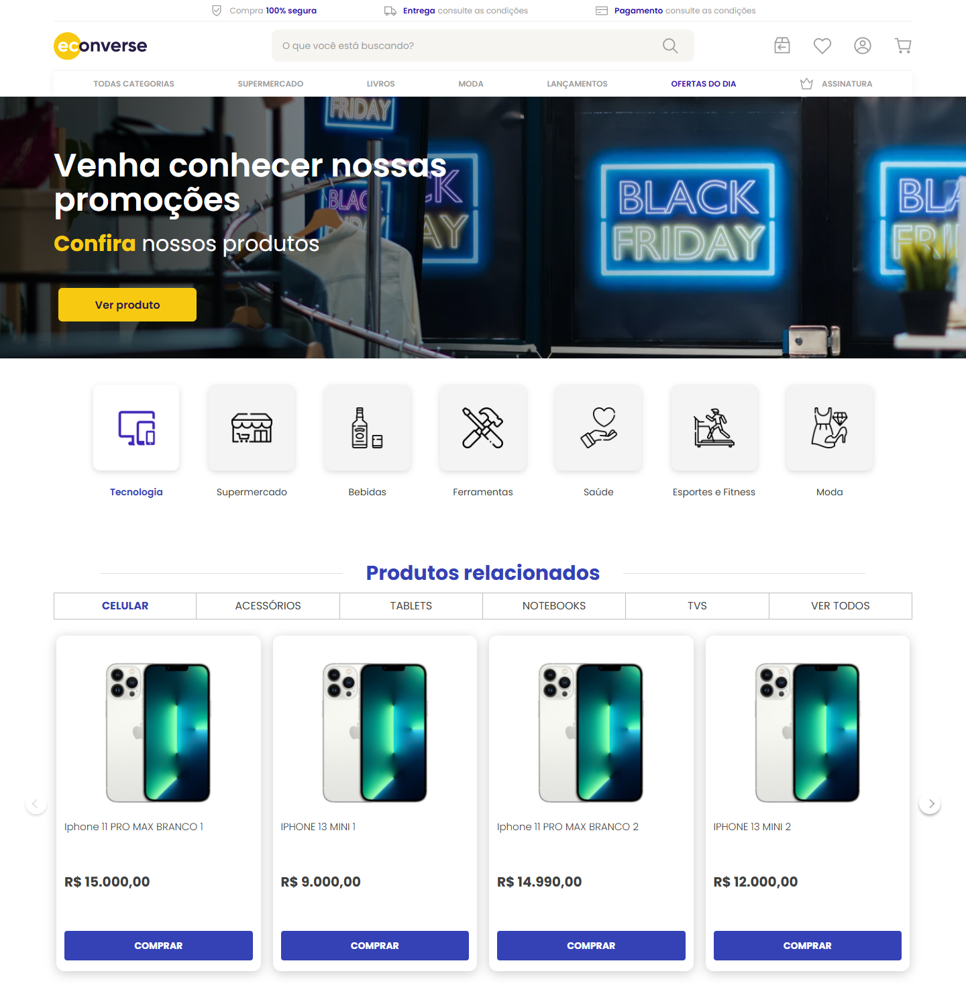

# Teste Front-end | Econverse

Desenvolvi este projeto como parte do processo seletivo da Econverse, usando React, TypeScript e Sass.

## Prévia



[Modal de produto](docs/screenshots/modal-desktop.png) · [Versão mobile](docs/screenshots/vitrine-390.png)

## Sobre o projeto

A página inicial reúne a vitrine e as seções do layout fornecido pela Econverse. Os dez produtos são carregados a partir do JSON do desafio. Ao clicar em um card ou no botão COMPRAR, um modal mostra a imagem, o nome, a descrição e o preço daquele produto.

Procurei manter os componentes reutilizáveis e deixar o acesso aos dados separado da apresentação.

## Funcionalidades

**Escopo do desafio**

- Vitrine com carrossel navegável e adaptação para telas menores.
- Modal com fechamento pelo botão, Escape ou clique no fundo e navegação por teclado.
- Consumo do JSON oficial, com carregamento, tratamento de erros e nova tentativa.
- Componentes em React e TypeScript, estilos em SCSS e HTML semântico, sem biblioteca de interface.

**O que acrescentei**

- Catálogo em `/produtos`, com busca e ordenação por preço, e página individual em `/produto/:slug`.
- Carrinho em `/carrinho` e favoritos, mantidos ao atualizar a página.

## Tecnologias

React, TypeScript em modo strict, Vite, Sass e React Router. Para os testes, usei Vitest, React Testing Library e Playwright.

## Como executar

É necessário ter Node.js 24 ou superior e npm instalados.

```bash
git clone https://github.com/alefkaue/teste-front-end.git
cd teste-front-end
npm ci
npm run dev
```

Abra `http://127.0.0.1:5173` ou o endereço informado no terminal.

Para compilar e conferir a versão de produção:

```bash
npm run build
npm run preview
```

## Testes

```bash
npm test
npm run typecheck
npm run test:e2e
```

Os E2E precisam do build de produção. No Windows, usam o Edge; em Linux e macOS, instale o navegador com `npx playwright install chromium`.

## Observações

- O acesso à API é necessário para iniciar o desenvolvimento e gerar o build. Na versão estática, o catálogo é atualizado a cada build.
- Carrinho e newsletter são demonstrativos, sem envio de pedidos ou inscrições.
- As [notas técnicas](docs/NOTAS-TECNICAS.md), a [revisão visual](docs/REFERENCIAS-VISUAIS.md) e os [créditos dos assets](docs/CREDITOS-VISUAIS.md) estão em `docs/`.

## Referências

- [Desafio oficial da Econverse](https://github.com/EconverseAG/teste-front-end)
- [Layout no Figma](https://www.figma.com/file/rWnzPeoxgynuNPsJjV0VmV/Teste-Front-End-Jr?node-id=0%3A1)
- [JSON de produtos](https://app.econverse.com.br/teste-front-end/junior/tecnologia/lista-produtos/produtos.json)
