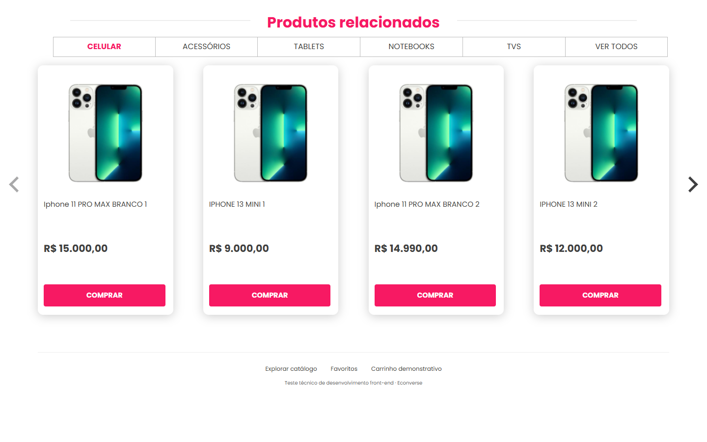
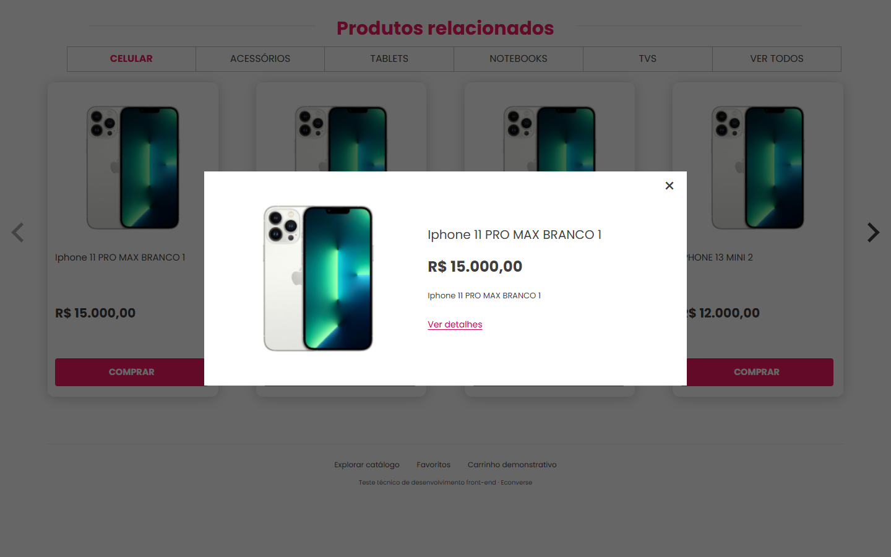

# Teste Front-end Econverse — Alef Kaue

Implementação do [desafio oficial da Econverse](https://github.com/EconverseAG/teste-front-end) em um fork legítimo, com React, TypeScript e Sass. O objetivo é reproduzir a vitrine rosa da referência e oferecer extensões coerentes, mantendo as funcionalidades extras fora do layout original dos cards.

**Repositório:** [alefkaue/teste-front-end](https://github.com/alefkaue/teste-front-end) · **Branch de entrega:** `main`.

As instruções da empresa estão preservadas em [DESAFIO-ORIGINAL.md](docs/DESAFIO-ORIGINAL.md). Este exercício é atribuído à Econverse; não representa uma loja oficial nem realiza compras.

## Capturas reais





[Mobile](docs/screenshots/vitrine-390.png) · [Detalhes](docs/screenshots/produto-desktop.png) · [Catálogo](docs/screenshots/catalogo-desktop.png)

## Instalação e execução

Requisitos: **Node.js 24 ou superior**, npm e acesso à internet para consultar a API. Ambiente validado com Node 24.19.0 e npm 11.17.0. As fontes Poppins são locais, com licença em `public/fonts/OFL.txt`.

```bash
git clone https://github.com/alefkaue/teste-front-end.git
cd teste-front-end
npm ci
npm run dev
```

Abra **http://127.0.0.1:5173** ou a porta informada pelo Vite. Para compilar e servir a versão de produção:

```bash
npm run build
npm run preview
```

O preview fica em **http://127.0.0.1:4173**. Use um servidor HTTP; não abra o `index.html` como arquivo.

## Testes

```bash
npm test
npm run typecheck
npm run build
npm run test:e2e
```

Os E2E iniciam o preview automaticamente e exigem um build prévio. No Windows usam o Microsoft Edge instalado. Em Linux/macOS usam o Chromium do Playwright, instalado com:

```bash
npx playwright install chromium
```

`PLAYWRIGHT_CHANNEL` permite escolher outro canal instalado. A workflow em `.github/workflows/validate.yml` instala as dependências do navegador e executa testes, build e E2E no Linux.

Resultado local: **28 testes de unidade/integração e 11 E2E aprovados**, além de TypeScript strict e build de produção. Consulte [VALIDACAO.md](docs/VALIDACAO.md) para a cobertura dos fluxos.

Para gerar novas capturas, mantenha `npm run dev` aberto e execute em outro terminal:

```bash
npm run screenshots
```

## Requisitos implementados

- React e TypeScript strict, Sass/SCSS e componentes reutilizáveis.
- Fetch API em serviço separado, validação do JSON, loading, erro, nova tentativa e imagem indisponível.
- Vitrine com quatro cards no desktop, dados oficiais, preço com `Intl.NumberFormat` e botão rosa COMPRAR.
- Carrossel próprio com avanço, retorno, limites, índice, adaptação à largura e teclado.
- Clique no produto ou COMPRAR abre o modal com os dados do item selecionado.
- Modal com botão de fechar, Escape, clique no fundo, bloqueio de scroll e gerenciamento do foco.
- HTML semântico, pt-BR, título e descrição por rota, textos alternativos, foco visível e link para pular ao conteúdo.
- Nenhuma biblioteca de interface ou carrossel.

## Funcionalidades extras

| Rota | Funcionalidade |
| --- | --- |
| `/` | Vitrine original e categorias; VER TODOS abre o catálogo. |
| `/produtos` | Grid dos dez produtos, busca por nome e ordenação por menor/maior preço. |
| `/produtos?favoritos=1` | Catálogo filtrado pelos favoritos. |
| `/produto/:slug` | Breadcrumb, imagem, nome, descrição, preço, quantidade, favoritos, adição ao carrinho e relacionados. |
| `/carrinho` | Itens, quantidades, remoção, subtotal e estado vazio. |

Categorias sem produtos exibem um estado vazio: a fonte disponibiliza apenas iPhones. Carrinho e favoritos usam `localStorage`, com validação dos dados e quantidades entre 1 e 99. Se o armazenamento falhar, continuam funcionando em memória e uma mensagem informa a limitação.

IDs e slugs são determinísticos, derivados de nome, descrição e imagem. Não dependem da posição, de aleatoriedade ou do preço: uma mudança de preço não invalida o item salvo.

## Consumo da API e CORS

Fonte: [JSON oficial da Econverse](https://app.econverse.com.br/teste-front-end/junior/tecnologia/lista-produtos/produtos.json).

Na verificação, o endpoint não enviava `Access-Control-Allow-Origin`, impedindo chamadas diretas de outro domínio no navegador. Para funcionar sem backend próprio:

1. Em desenvolvimento, o serviço consulta `/api/produtos.json`; o proxy do Vite encaminha a requisição à API oficial.
2. Antes de `dev` e `build`, `scripts/sync-products.mjs` baixa e valida o JSON. Se a fonte falhar, o comando falha em vez de inventar dados.
3. Em produção, a Fetch API carrega `/data/produtos.json`, gerado pelo build. `/data/origem.json` registra a fonte e a data de obtenção.

Os arquivos gerados não são versionados. **A produção estática representa os dados do último build**; um novo build atualiza o catálogo. Não há produtos escritos manualmente na aplicação nem dependência de proxy público de terceiros. A fixture dos testes é isolada e não participa do bundle.

Os números de `price` são exibidos como reais, sem dividir por 100: a API não documenta centavos. Não são inventados descontos, parcelamentos, frete, estoque ou especificações técnicas.

## Organização e tecnologias

```text
src/
  components/   # Cards, carrossel, modal, categorias, grid, header e controles
  context/      # Produtos, modal, carrinho e favoritos
  hooks/        # Persistência local e metadados
  pages/        # Home, catálogo, detalhes e carrinho
  services/     # Fetch e validação da API
  styles/       # SCSS e tokens visuais
  tests/        # Serviço, integração e fixture oficial
  types/        # Contratos de dados
  utils/        # Identidade, preços, busca e quantidades
e2e/            # Jornadas em navegador real
scripts/        # Sincronização da API e capturas
docs/           # Desafio original, medidas, validação e capturas
```

Dependências de execução: React, React DOM e React Router. Desenvolvimento: Vite, TypeScript, Sass, Vitest, React Testing Library e Playwright. O modal usa `<dialog>` nativo; o carrossel usa CSS e estado React. Não há backend.

## Referências e fidelidade visual

[Vitrine oficial](https://app.econverse.com.br/teste-front-end/junior/tecnologia/layout/vitrine-produtos.png) · [Figma original](https://www.figma.com/file/rWnzPeoxgynuNPsJjV0VmV/Teste-Front-End-Jr?node-id=0%3A1) · [Cópia disponibilizada](https://www.figma.com/design/8sb81wsImNxDHlD1C6IK3U/Untitled?node-id=0-1).

A imagem da vitrine rosa foi a referência principal. Capturas reais foram comparadas em **1834, 1440, 1024, 768, 390 e 375 px**. Os E2E verificam ausência de overflow em vitrine, modal, detalhes, catálogo e carrinho nas cinco larguras solicitadas.

Não houve acesso ao Dev Mode: medidas, fonte e sombra foram estimadas e ajustadas visualmente. A prévia pública do Figma orientou a composição do modal. Os textos reais, a ausência de condições comerciais ilustrativas e a baixa resolução da imagem original produzem diferenças. Não se afirma igualdade absoluta pixel a pixel. Veja [REFERENCIAS-VISUAIS.md](docs/REFERENCIAS-VISUAIS.md).

## Publicação e limitações

O código é entregue em `main` neste fork. Não houve deploy em Vercel/Netlify: não havia sessão dessas plataformas disponível. `vercel.json` e `public/_redirects` preparam o fallback das rotas SPA, mas não foram verificados em hospedagem publicada.

- A API deve estar disponível para sincronizar os dados antes de `dev` e `build`; as imagens dependem do servidor oficial.
- Na produção estática, os produtos são atualizados por novo build, conforme a seção de CORS.
- Carrinho e favoritos são locais, sem conta, backend, pagamento ou sincronização entre dispositivos.
- Testado em Edge/Chromium; Safari, Firefox e aparelhos físicos não foram verificados.
- É uma SPA com metadados por rota, sem renderização no servidor.
- Nenhuma funcionalidade obrigatória está pendente. O deploy permanece opcional.
